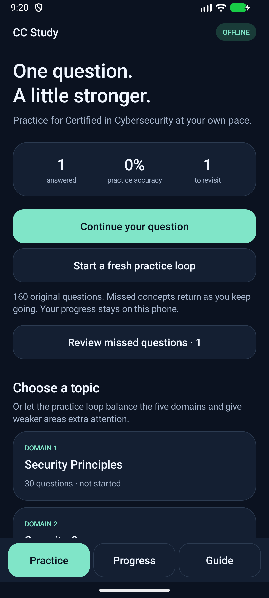
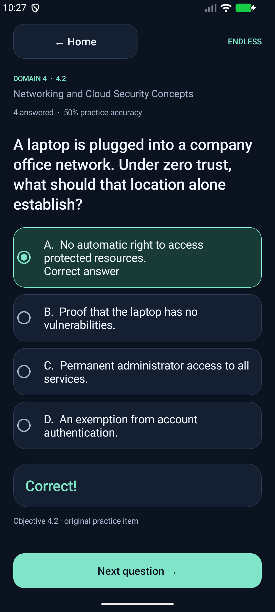
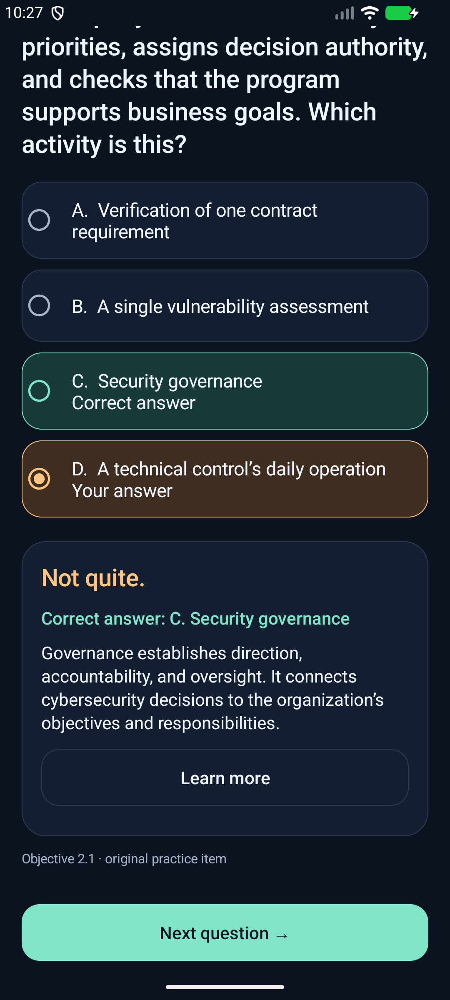

# CC Study

**Small practice sessions. Clear explanations. Progress that stays with you.**

An independent, offline Android study app for Certified in Cybersecurity.

**[Download for Android · 2.98 MB](https://github.com/HumanMeatSack/cc-study/releases/download/v1.0.1-beta.1/CC-Study-1.0.1.apk)** · [Install guide](INSTALL.md) · [Release page](https://github.com/HumanMeatSack/cc-study/releases/tag/v1.0.1-beta.1)

Android 12+ · 160 original questions · Five domains · Free beta

## Practice at your pace

- **Keep going:** shuffled questions, topic focus, and extra practice on weaker areas.
- **Keep moving:** correct answers show a brief confirmation and wait for Next.
- **Learn from a miss:** wrong answers show the correct choice and a short explanation; Learn more reveals the other choices’ rationales.
- **Review mistakes:** return to questions whose most recent answer was incorrect.
- **Pick up later:** your current question, selected answer and progress are saved locally.
- **Study offline:** no account, AI download or background connection needed.

The 160-item starter bank follows the [CC outline effective September 1, 2026](https://www.isc2.org/certifications/cc/cc-certification-exam-outline). Endless practice means reshuffling and revisiting this finite bank.

## Take a look

  
  
  

Screenshots show synthetic practice data on an Android emulator.

## Install

1. Open the **[APK download](https://github.com/HumanMeatSack/cc-study/releases/download/v1.0.1-beta.1/CC-Study-1.0.1.apk)** on your Android phone.
2. Open the finished download and choose **Install**, then **Open**. Android may ask you to allow installation from that browser.
3. Tap **Start endless practice**, choose an answer, then **Check answer**.

Download the `.apk` file. GitHub's automatically generated “Source code” ZIP contains this download repository's documentation, not an installable app.

For the APK together with installation notes and third-party license texts, use the [complete package](https://github.com/HumanMeatSack/cc-study/releases/download/v1.0.1-beta.1/CC-Study-1.0.1-package.zip). [Checksums](https://github.com/HumanMeatSack/cc-study/releases/download/v1.0.1-beta.1/SHA256SUMS.txt) and [third-party notices](https://github.com/HumanMeatSack/cc-study/releases/download/v1.0.1-beta.1/THIRD_PARTY_NOTICES.txt) are provided alongside the downloads.

## Privacy

Practice progress is stored on the phone. This build requests no Android permissions and contains no analytics, advertising SDK, login, or billing integration. The optional official-source buttons open your browser. See [Privacy](PRIVACY.md).

## Beta scope

This is the initial personal-study beta: English, single-answer questions and a curated starter bank. It is AI-assisted educational material, not recalled exam content. Please report confusing questions, suspected errors and usability problems through [GitHub Issues](https://github.com/HumanMeatSack/cc-study/issues). Include the objective/question wording and omit personal information.

The 1.0.1 build passed 26 automated tests and Android lint with no errors. The exact APK passed Android 16 emulator upgrade, answer-flow and restart checks, including preserved study progress. The owner reported successful Galaxy S24 Ultra use of version 1.0; the 1.0.1 update has not yet been verified on that handset. This does not establish compatibility on every Android device.

This beta is debug-signed for early feedback and has no automatic updater. Install a matching signed update over the existing app to keep progress; uninstalling clears it. A future production distribution may need a separate migration/signing plan. See [install and update details](INSTALL.md).

## About this repository

This public repository provides the compiled app, installation instructions and feedback tracker. The application's development source is kept private. No application source-code license is granted by this download repository; third-party components retain their own licenses in [licenses/](licenses/).

CC Study is an independent project, not affiliated with or endorsed by ISC2. Practice accuracy is a learning measure, not an official exam score or pass prediction. ISC2 and CC are their owners' marks.
